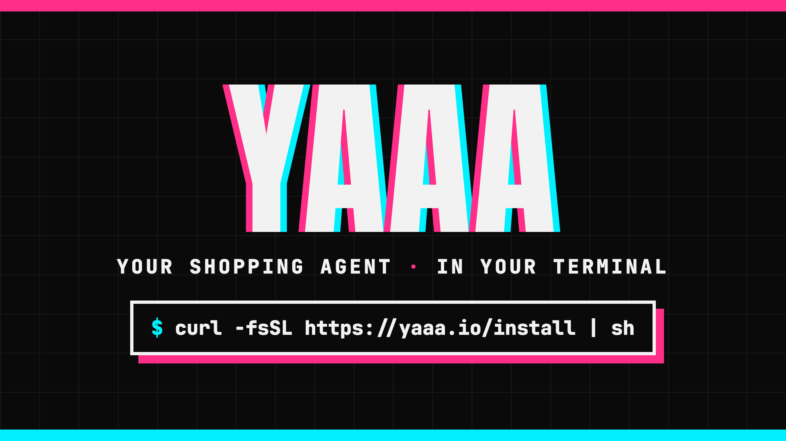

<p align="center"></p>

This repo is the yaaa command-line tool, agent skills and API contract. The yaaa service itself (api.yaaa.io) isn't open source.

# yaaa

YAAA (Yet Another AI Agent), by [NxisAI](https://nxis.ai), lets the AI agent in your terminal buy from online stores at retail, in your name: right now, when a price drops, when something new fits a search, or on a schedule. Every purchase ends with a confirm link that opens the store's own checkout, where you pay the store directly. yaaa never touches your card.

yaaa is in beta, for US-based Shopify stores that support agent checkout (UCP). Docs: [yaaa.io/docs](https://yaaa.io/docs/).

## Install

```sh
curl -fsSL https://yaaa.io/install | sh   # macOS and Linux; on Windows, inside WSL
yaaa init                                 # an anonymous account (no sign-up), and the skills for your agents
```

Then ask your agent, for example Claude Code: "find me trail running shoes under $120 and get a quote on the best one". [Getting started](https://yaaa.io/docs/) covers the rest, and the [command reference](https://yaaa.io/docs/reference/) lists every command.

## What's here

| Path | What it is |
| --- | --- |
| `cli/packages/cli` | The `yaaa` command |
| `cli/packages/tools` | The operations, shared by the commands and the MCP server (`yaaa mcp`) |
| `cli/packages/client` | The API client, generated from `proto/` |
| `cli/packages/skills` | The agent skills: `yaaa-buyer` (buys) and `yaaa-advisor` (recommends) |
| `cli/release` | The installer and release builds |
| `proto/yaaa/v1` | The API contract: every call the CLI makes |

## What yaaa sends, and where

- **api.yaaa.io**: the calls defined in `proto/`: your searches, quotes, watches, restocks, alert settings, and account. `yaaa init` sends a device name (by default `username@hostname`; change it with `--device-name`) so you can tell your devices apart on the web desk.
- **yaaa.io**: checking for and downloading updates (`/releases/latest`, `/install`).
- **Store image hosts** (usually Shopify's CDN): product pictures, fetched directly when yaaa shows them in your terminal or a notification. Turn them off with `yaaa config images off`.
- **Nothing else.** yaaa collects no telemetry or analytics today. If that changes, it will be documented here and in our [Privacy Policy](https://yaaa.io/privacy/) before it ships, announced in the release notes, and you'll be able to turn it off.

When your AI agent runs yaaa, it reads the results, so they become part of your conversation with that agent and its provider. See the [Privacy Policy](https://yaaa.io/privacy/) for how yaaa handles your data, and the [Terms](https://yaaa.io/terms/).

## Build from source

Needs Node.js 22.12 or newer and pnpm 10.

```sh
cd cli
pnpm install
pnpm build                    # generates the client from proto/, then builds
pnpm test
node packages/cli/dist/main.js --help
```

## Contributing

Issues are welcome: bugs, ideas, and questions. We're not accepting pull requests yet; see [CONTRIBUTING.md](CONTRIBUTING.md). This repo is a mirror: changes land here with each release. Help and discussion: the [YAAA Discord](https://discord.gg/RzukGnVBRA). Security issues: see [SECURITY.md](SECURITY.md), not public issues.

## License

Apache License 2.0; see [LICENSE](LICENSE) and [NOTICE](NOTICE). "yaaa" and the yaaa logo are trademarks of NxisAI LLC and aren't covered by the license.
